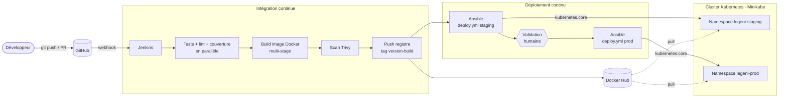

# PROJET FINAL DEVOPS – Chaîne CI/CD complète « du commit à la production »

**Par Thomas BOGNI-DANCHI** – Travail en binôme – Durée : 3 semaines (≈ 15 h de travail personnel) + soutenance de 20 min

---

## 1) Contexte

La société **LEGENI CONSULTING** développe l'application web *Legeni WebApp* (Python/Flask + Redis), fournie dans le dossier [`app-fil-rouge/`](../app-fil-rouge/) et utilisée dans tous les TPs du cours.

Aujourd'hui, les mises en production se font à la main : un développeur construit l'image sur son poste, la copie sur le serveur et relance les conteneurs. Résultat : des oublis, des coupures de service, et personne ne sait quelle version tourne en production.

En tant qu'ingénieur(e) DevOps, vous devez livrer une **chaîne entièrement automatisée** :

> Un développeur pousse son code sur Git. **Sans aucune autre action manuelle qu'une validation avant la production**, le code est testé, analysé, empaqueté dans une image, publié dans un registre, déployé en *staging* sur Kubernetes, vérifié, puis déployé en *production* sans interruption de service – avec retour arrière automatique en cas de problème.

Le projet mobilise **tous** les outils du cours : Git, Docker, Jenkins, Ansible, Kubernetes.

## 2) Architecture cible



Infrastructure (au choix) :

| Option | Machines | Usage |
|---|---|---|
| **A – une VM** (recommandée) | 1 VM Ubuntu 24.04, 4 vCPU, 8 Go RAM : Jenkins en conteneur + Minikube | poste personnel / WSL2 |
| **B – deux VM** | VM « ci » (Jenkins) + VM « k8s » (Minikube) | plus réaliste, VirtualBox/Vagrant ou cloud |

Dans les deux cas, **l'infrastructure elle-même est installée par Ansible** (`provision.yml`) : aucune installation manuelle de Docker, Jenkins ou Minikube n'est acceptée.

## 3) Dépôt attendu

Un dépôt GitHub par binôme, structuré ainsi :

```
legeni-webapp/
├── app.py, tests/, requirements*.txt     # application (fournie)
├── Dockerfile, .dockerignore             # Lot 1
├── VERSION                               # numéro de version sémantique (ex. 1.0.0)
├── Jenkinsfile                           # Lots 4 et 5
├── ansible/
│   ├── ansible.cfg, inventory.ini
│   ├── provision.yml                     # Lot 2 : installe Docker, Jenkins, Minikube
│   ├── deploy.yml                        # Lot 3 : déploie l'application dans Kubernetes
│   ├── roles/                            # docker, jenkins, minikube…
│   ├── templates/k8s/                    # manifests Kubernetes (Jinja2) — ou k8s/ en Kustomize
│   └── vars/ (staging.yml, prod.yml, vault.yml chiffré)
└── docs/
    └── rapport.md                        # rapport final
```

## 4) Travail demandé – 6 lots

Chaque lot correspond à des TPs déjà réalisés : **réutilisez votre travail**.

### Lot 0 – Organisation Git (TP Git) – *1 pt*
- Dépôt GitHub, branche `main` **protégée** : merge uniquement par *pull request* avec build Jenkins vert.
- Chaque fonctionnalité est développée dans une branche `feature/...`.
- Messages de commit explicites ; un tag Git `v<VERSION>` par mise en production.

### Lot 1 – Conteneurisation (TP 2.3 à 2.9) – *3 pts*
- `Dockerfile` **multi-stage** : une étape `test` (flake8 + pytest) et une étape finale minimale.
- Utilisateur non-root, `HEALTHCHECK`, version injectée par `--build-arg APP_VERSION`, `CMD` en forme exec (arrêt propre, TP 2.5), configuration uniquement par variables d'environnement.
- Zéro vulnérabilité `CRITICAL` corrigeable (Trivy) ; `hadolint` sans erreur.
- Tag d'image : `<VERSION>-<numéro de build>` (ex. `1.2.0-37`). **Jamais `latest` en production.**

### Lot 2 – Infrastructure as Code (TP 5.1 à 5.5) – *3 pts*
- `provision.yml` installe, sur une machine vierge, Docker, Jenkins (image du TP 3.1) et Minikube (driver docker, addons `metrics-server` et `ingress`).
- Rôles réutilisables, variables dans `defaults/`, idempotence prouvée (2ᵉ exécution : `changed=0` hors tâches de vérification).
- Tous les secrets (mots de passe Redis, etc.) sont dans `vars/vault.yml` **chiffré avec Ansible Vault**.

### Lot 3 – Déploiement Kubernetes (TP 4.7 à 4.12, TP 5.6) – *4 pts*
- Deux namespaces : `legeni-staging` et `legeni-prod`, mêmes manifests, paramètres différents (réplicas, couleur, NodePort ou Ingress).
- Redis en **StatefulSet** avec volume persistant ; mot de passe dans un **Secret**.
- Application : `Deployment` avec `readinessProbe` (`/ready`), `livenessProbe` (`/health`), `requests`/`limits`, stratégie `RollingUpdate` avec `maxUnavailable: 0`.
- `deploy.yml` (Ansible, module `kubernetes.core.k8s`) : applique les manifests, **attend la fin du rolling update**, exécute un **smoke test** qui vérifie la version déployée, et fait un **rollback automatique** (`block`/`rescue`) en cas d'échec.

### Lot 4 – Intégration continue (TP 3.5 à 3.7) – *4 pts*
- Job **Multibranch** déclenché par **webhook** GitHub.
- Stages : contrôles qualité **en parallèle** (tests + couverture ≥ 80 %, flake8, hadolint, syntaxe Ansible) → build → scan Trivy → push (branche `main` uniquement).
- Rapports publiés dans Jenkins : JUnit, couverture, warnings.
- Aucun secret dans le Jenkinsfile : uniquement des *credentials* Jenkins (`registry-credentials`, `kubeconfig`, `ansible-vault-pass`).

### Lot 5 – Déploiement continu (TP 3.8, TP 5.6) – *3 pts*
- Sur `main` uniquement : déploiement automatique en staging par Ansible → **validation humaine** (`input`) → déploiement en production par Ansible.
- Les branches `feature/*` et les pull requests ne déploient jamais.
- Notification (e-mail, Slack, Discord ou Teams) en cas d'échec.

### Rapport et soutenance – *2 pts*
Voir § 6.

### Bonus (jusqu'à +3 pts, note plafonnée à 20)
- **Ingress** avec noms d'hôte `staging.legeni.local` / `legeni.local` et TLS (+1)
- **HPA** sur l'application en production + démonstration de montée en charge (+1)
- **Supervision** : Prometheus + Grafana (chart Helm `kube-prometheus-stack`), tableau de bord de l'application (+1)
- **GitOps** : Argo CD synchronise le namespace prod depuis le dépôt ; Jenkins ne fait plus que modifier le tag dans Git (+2)
- Pipeline de **destruction/reconstruction** complète de l'environnement en une commande (+1)
- **Job Kubernetes** d'initialisation/migration lancé par le pipeline avant le rolling update (`kubectl wait --for=condition=complete`), et **CronJob** de contrôle de santé en production (TP 4.6) (+1)

## 5) Jalons

| Semaine | Jalon | Livrable vérifié en séance |
|---|---|---|
| S1 | Lots 0, 1, 2 | `ansible-playbook provision.yml` sur une VM vierge → Jenkins et Minikube opérationnels ; image publiée sur Docker Hub |
| S2 | Lots 3, 4 | `ansible-playbook deploy.yml -e target_env=staging …` fonctionne à la main ; pipeline CI vert sur une PR |
| S3 | Lot 5, bonus, rapport | Démonstration complète du scénario de soutenance |

## 6) Soutenance : scénario imposé (démonstration en direct, 10 min)

Le jury vous demandera d'enchaîner, **sans toucher au serveur à la main** :

1. **Livraison nominale** : modifier la couleur par défaut de l'application, passer `VERSION` à `1.1.0`, ouvrir une PR → build vert sur la PR, pas de déploiement → merge → staging mis à jour automatiquement → validation → production mise à jour. Une boucle `curl` sur la production doit montrer **0 erreur** pendant la mise à jour.
2. **Code défectueux** : pousser un test qui échoue → pipeline rouge à l'étape tests, **aucune image produite**, production inchangée.
3. **Déploiement raté** : déployer une version dont les pods ne démarrent pas (ex. `readinessProbe` sur un mauvais chemin) → rollback automatique visible dans Jenkins, production toujours servie par la version précédente.
4. **Question surprise** sur un fichier de votre dépôt (« que fait cette ligne ? »).

Le **rapport** (`docs/rapport.md` ou PDF, 15 pages max.) contient : schéma d'architecture, choix techniques justifiés, explication du pipeline stage par stage, captures (Stage View, rapports de tests, `kubectl get all`, rollback), difficultés rencontrées et solutions, pistes d'amélioration.

## 7) Grille d'évaluation (/20)

| Critère | Points | Attendus pour la note maximale |
|---|---|---|
| Lot 0 – Git | 1 | `main` protégée, PR, tags de version |
| Lot 1 – Docker | 3 | multi-stage avec tests, non-root, healthcheck, 0 CRITICAL, tags traçables |
| Lot 2 – Ansible / IaC | 3 | infra reconstruite depuis zéro par `provision.yml`, rôles, idempotence, Vault |
| Lot 3 – Kubernetes | 4 | 2 environnements, StatefulSet + PVC, Secret, probes, ressources, rollback auto |
| Lot 4 – CI Jenkins | 4 | multibranch + webhook, parallélisme, rapports, quality gates, zéro secret en clair |
| Lot 5 – CD | 3 | staging auto, validation, prod sans coupure, branches non déployées, notification |
| Rapport + soutenance | 2 | scénario du § 6 réussi, explications claires, réponses précises |
| Bonus | +3 | voir § 4 |

**Pénalités** : secret en clair dans le dépôt (−3) ; installation manuelle non décrite dans le code (−2) ; image `latest` déployée en production (−1).

## 8) Ressources

- TPs : [`TP docker/`](../TP%20docker/), [`TP_jenkins/`](../TP_jenkins/), [`TP kubernetes/`](../TP%20kubernetes/), [`TP ansible/`](../TP%20ansible/)
- Image Jenkins prête à l'emploi : [`TP_jenkins/jenkins-docker/`](../TP_jenkins/jenkins-docker/)
- Rôles Ansible de départ : [`TP ansible/lab/roles/`](../TP%20ansible/lab/roles/)
- Connecter Jenkins (conteneur) au cluster Minikube de la même machine :
	```bash
	docker network connect minikube jenkins
	kubectl config view --flatten --minify > kubeconfig-jenkins.yml   # à ajouter comme credential "Secret file"
	```
	L'adresse du serveur dans ce fichier (`https://192.168.49.2:8443`) est alors joignable depuis Jenkins.
- Fiches mémo : [`Support de cours/Fiches memo/`](../Support%20de%20cours/Fiches%20memo/)

> L'ancien sujet (IC GROUP : Odoo 13 + pgAdmin + site vitrine) reste disponible dans [`Projet final/Guide.md`](../Projet%20final/Guide.md). Il peut servir de **sujet alternatif** en remplaçant l'application fil rouge par le site vitrine + Odoo (version 17 ou 18, Odoo 13 et `python:3.6` n'étant plus maintenus).
